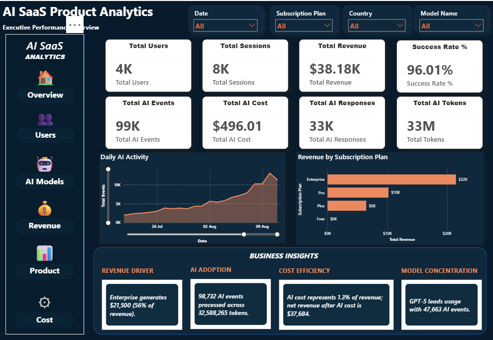
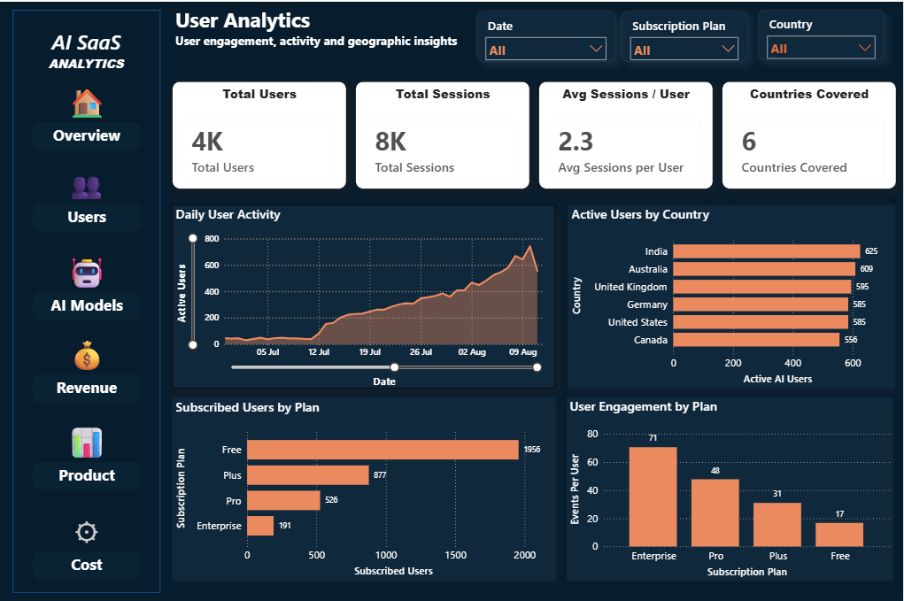
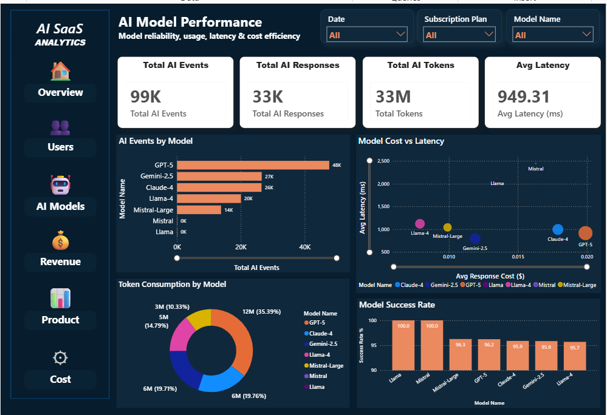
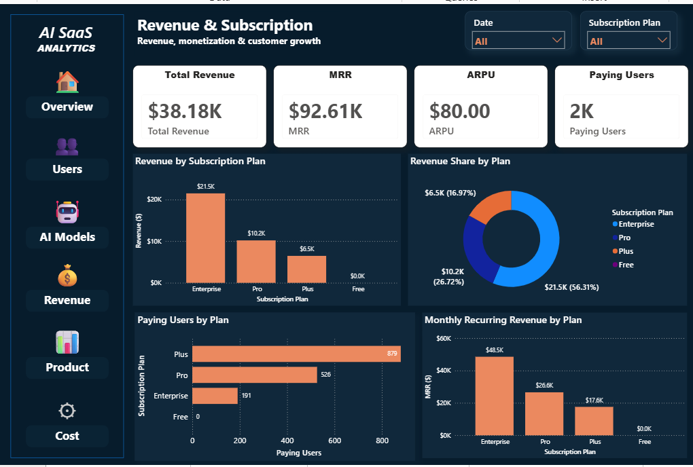
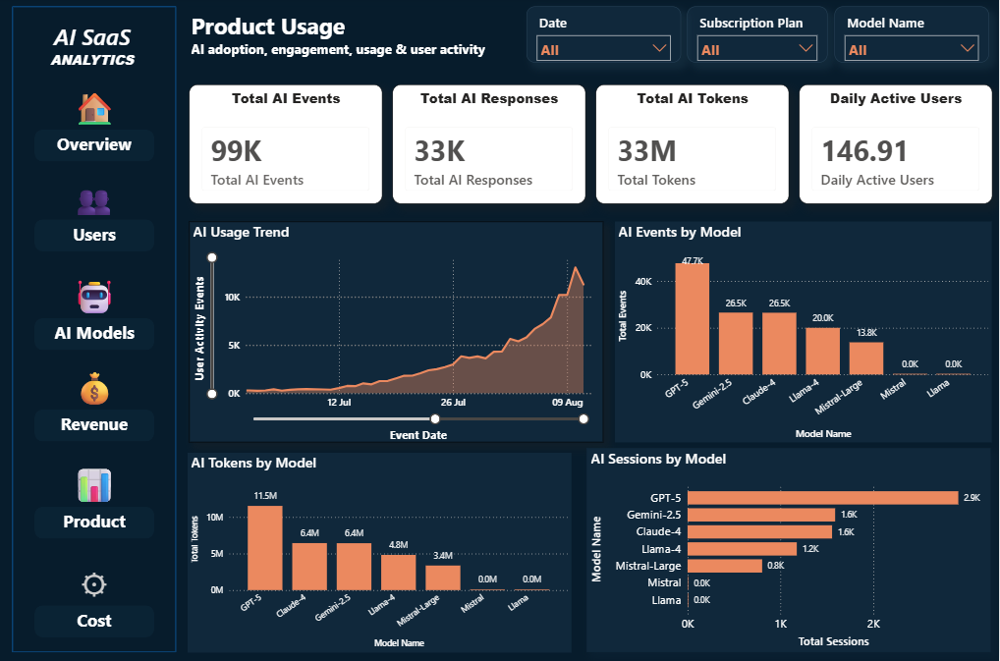
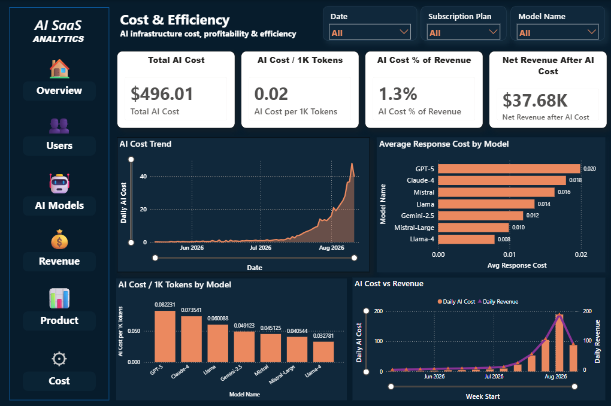

# AI SaaS Product Analytics Platform

An end-to-end analytics engineering project that transforms synthetic AI SaaS telemetry into business-ready insights using Python, AWS, dbt, and Power BI.

## Architecture

**Python → Amazon S3 → AWS Glue → Amazon Athena → dbt → Power BI**

The platform follows a cloud-based analytics architecture to organize AI product telemetry, transform data into analytical models, and deliver business insights through interactive dashboards.

## Tech Stack

- **Programming:** Python, SQL
- **AWS:** Amazon S3, AWS Glue Data Catalog, Amazon Athena
- **Analytics Engineering:** dbt Core, dbt-athena
- **Business Intelligence:** Power BI, DAX, Power Query
- **Tools:** Git, GitHub

## Analytics Marts

The platform provides nine analytics marts covering:

- Executive KPIs and user activity
- Revenue and subscriptions
- AI model performance and prompt usage
- Country-level metrics
- Sessions and user feedback

## Power BI Dashboard Preview

The Power BI report contains six dashboard pages designed to analyze AI SaaS product performance, user engagement, revenue, subscriptions, product usage, and AI costs.

### 1. Executive Overview

Provides a consolidated view of business performance through executive KPI cards, daily AI activity, revenue by subscription plan, and business insights.

Key metrics include total users, sessions, revenue, success rate, AI events, AI cost, AI responses, and AI tokens.



### 2. User Analytics

Presents user activity and engagement insights to help understand how users interact with the AI SaaS platform.



### 3. AI Model Performance

Provides insights into AI model usage, model-level activity, responses, and token consumption.



### 4. Revenue & Subscription

Highlights revenue performance and subscription-related metrics across different subscription plans.



### 5. Product Usage

Provides an analytical view of product adoption, prompt activity, and AI product usage patterns.



### 6. Cost Analytics

Focuses on AI expenditure and cost-related metrics to support analysis of platform cost efficiency.



## Validation Results

- 18 dbt models discovered: 9 staging and 9 mart models
- All 9 configured dbt data-quality tests passed
- All 9 Athena marts successfully checked for row counts
- Nine Power BI Athena-connected queries refreshed successfully in the verified cloud-connected copy

*Validation performed on October 11, 2026. Results may change as the underlying data changes.*

## Project Structure

```text
AI-SaaS-Product-Analytics-Platform/
|-- config/
|-- dashboards/
|   |-- ai-model-performance.png
|   |-- cost-analytics.png
|   |-- executive-overview.png
|   |-- product-usage.png
|   |-- revenue-subscription.png
|   `-- user-analytics.png
|-- data/
|-- dbt/
|   `-- ai_saas_analytics/
|       |-- models/
|       |   |-- staging/
|       |   `-- marts/
|       `-- requirements.txt
|-- documentation/
|-- generators/
|-- check_marts.py
|-- requirements.txt
`-- README.md
```

## Getting Started

**Prerequisites:** Python 3.11, AWS CLI, Git, and access to the required AWS resources.

### 1. Clone the repository

```powershell
git clone https://github.com/akash-chaudhary2004/AI-SaaS-Product-Analytics-Platform.git
cd AI-SaaS-Product-Analytics-Platform
```

### 2. Create and activate a virtual environment

```powershell
python -m venv .venv-dbt
.\.venv-dbt\Scripts\Activate.ps1
```

### 3. Install dependencies

```powershell
python -m pip install -r dbt\ai_saas_analytics\requirements.txt
```

### 4. Configure AWS and dbt

Configure AWS authentication and your dbt profile at:

```text
%USERPROFILE%\.dbt\profiles.yml
```

Ensure the required AWS resources, permissions, and Athena configuration are available.

### 5. Validate the project

```powershell
dbt parse --project-dir dbt\ai_saas_analytics
dbt test --project-dir dbt\ai_saas_analytics
python check_marts.py
```

**Note:** AWS resources and permissions must be configured before running cloud validations. Athena queries may incur charges. Automated event-to-S3 ingestion from a fresh clone has not yet been verified.

## Future Improvements

- Automate ingestion and pipeline scheduling
- Expand business-logic and relationship tests
- Add CI/CD and pipeline monitoring
- Document dashboard insights and cloud costs

## Skills Demonstrated

Python, SQL, dbt, data modeling, data quality testing, AWS S3, AWS Glue, Amazon Athena, Power BI, DAX, Power Query, analytics engineering, and business intelligence.

## Author

**Akash Kumar**

B.Tech in Smart Manufacturing

PDPM, Indian Institute of Information Technology, Jabalpur